.. _Acquisition-Controls:

Acquisition Controls
====================

This guide assumes you have installed the driver and software for ThunderScope. 
If you have not already done do, please follow the :ref:`getting started guide <Getting-Started>`.

Sample Rate
-----------

To change the sample rate, click on the down arrow next to "Sample Rate" on the stream browser menu

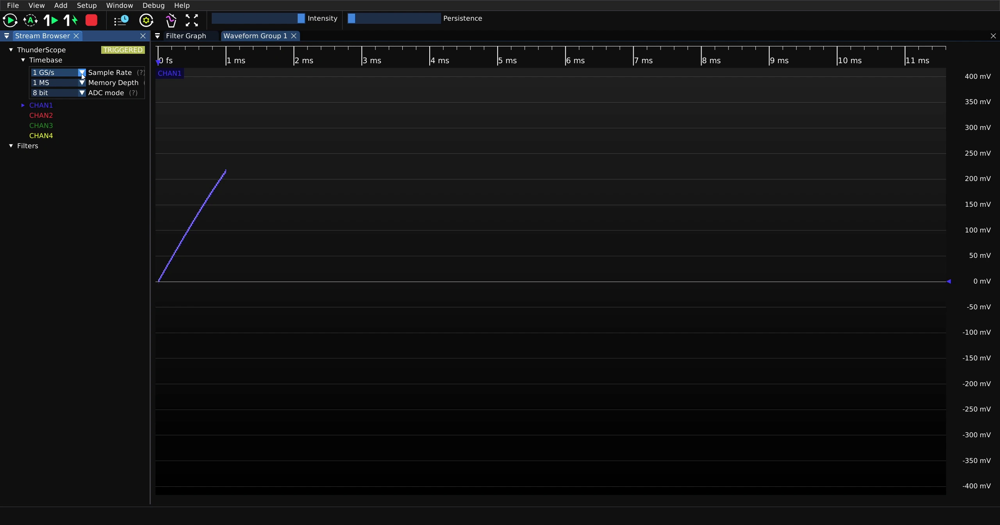

Then click on the desired sample rate from the drop down menu

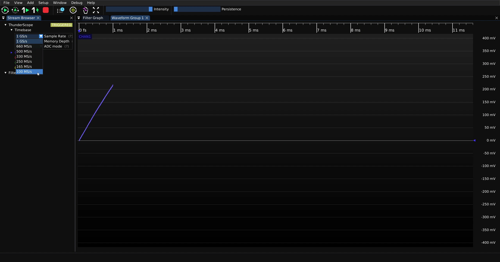

Note that lowering sample rate will increase capture length for a given memory depth and vice versa

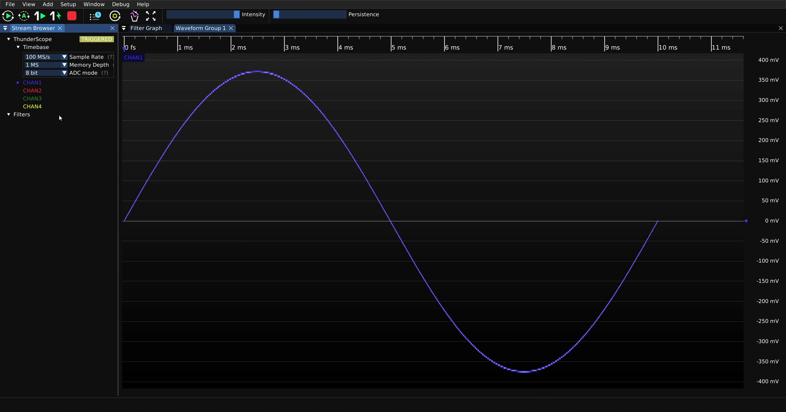

Changing sample rate can have a drastic effect on the captured waveform due to `Nyquist's Theorem <https://en.wikipedia.org/wiki/Nyquist%E2%80%93Shannon_sampling_theorem>`_.
Shown below is the a 10 MHz square wave captured at decreasing sample rates, starting with 1 GS/s:

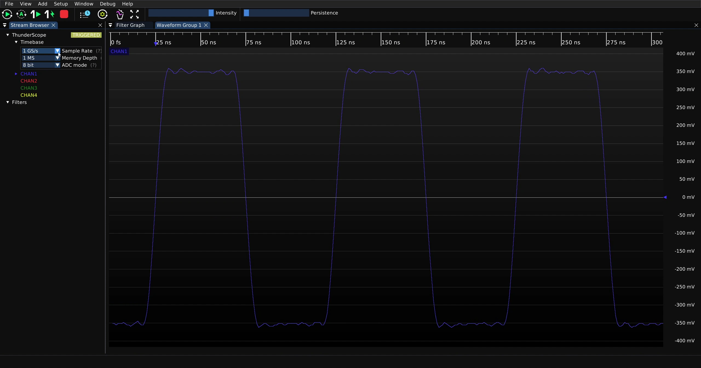

500 MS/s:

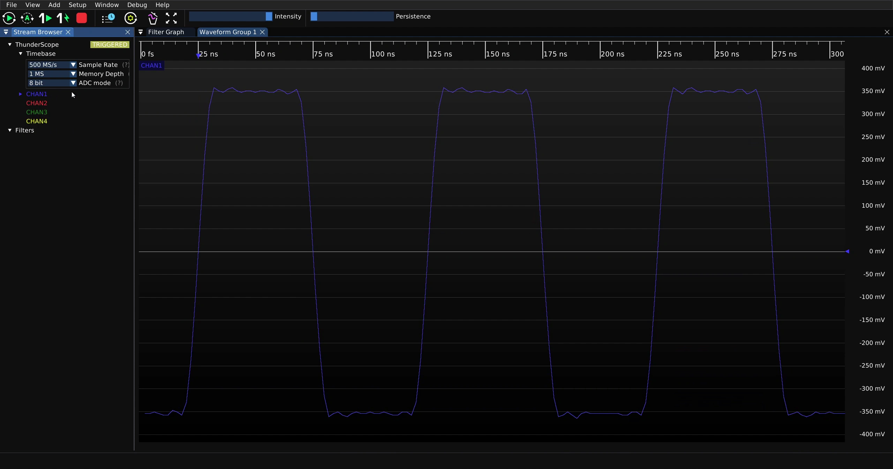

250 MS/s:

100 MS/s:

.. note::
    The effect shown above is compounded by the straight line interpolation used by ngscopeclient, 
    you can use the Upsample filter to get a more typical sine x/x interpolation. 
    For more on this, check out the :ref:`Introduction to Filters <Filter-Intro>` page.

Memory Depth
------------

To change the per channel memory depth, click on the down arrow next to "Sample Rate" on the stream browser menu

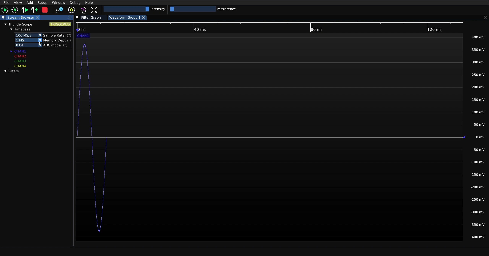

Then click on the desired memory depth from the drop down menu

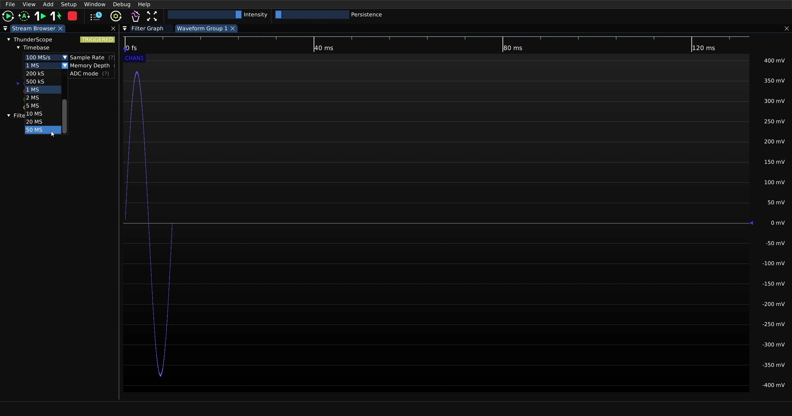

Note that increasing the memory depth will increase capture length and vice versa.

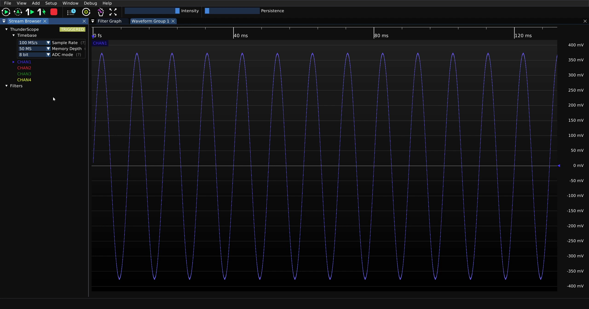

The default maximum memory depth is set to 50 MS. This is about the limit for hosts with low end GPUs, such as intel iGPUs.
If you have a more capable host, you can change the ``MaxCaptureLength`` value in ``settings.yaml``, located in the follow directory:

.. tab:: Linux

    .. code::

        $XDG_CONFIG_HOME/ThunderScope/TS.NET.Engine/settings.yaml
        
    or

    .. code::

        $HOME/.config/ThunderScope/TS.NET.Engine/settings.yaml

.. tab:: Windows

    .. code::

        %AppData%\Local\ThunderScope\TS.NET.Engine

.. tab:: macOS

    .. code::

        ~/Library/Application Support/ThunderScope/TS.NET.Engine/settings.yaml

Waveform History
----------------

By default, ngscopeclient records 10 captures in history. This is similar to segmented memory features on other oscilloscopes. 
The captures in history can be accessed in the "History" window. To open the "History" window, click on "Window" on the main menu at the top of the window. 

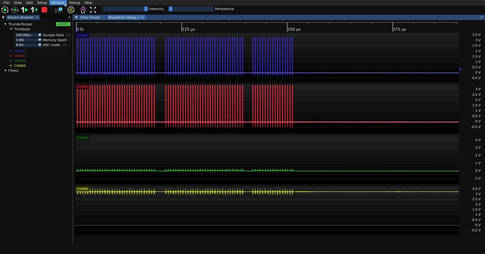

Then click on "History"

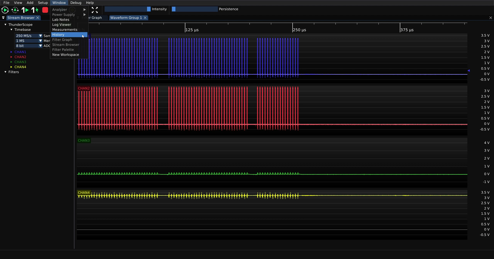

This will spawn the History window, here it is docked to the lower left corner.

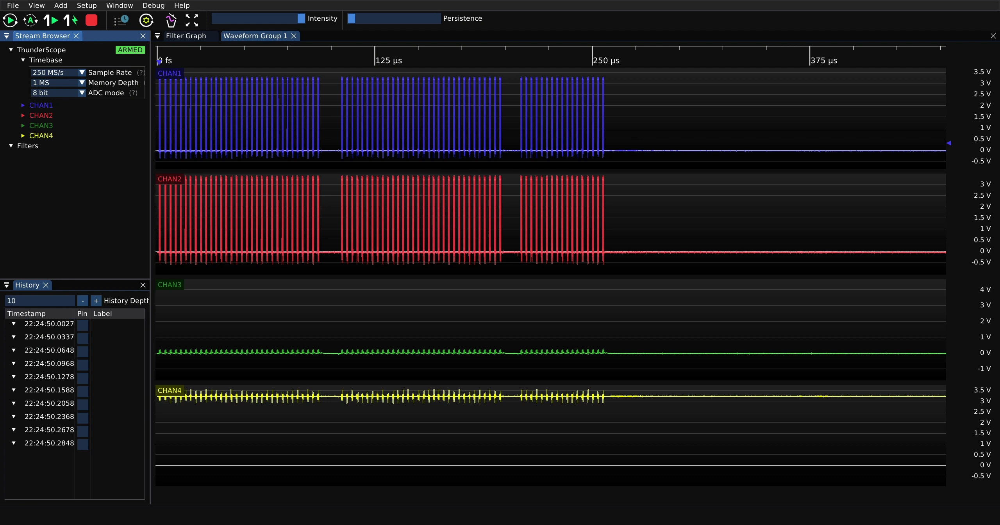

Clicking on a timestamp in the history view pauses acquisition and loads the historical waveform data for analysis.

Older captures beyond the history limit are deleted automatically as new captures are acquired.
A capture in history can be pinned, which saves it from deletion.
A label can also be added to any capture in history, this will always pin that capture.

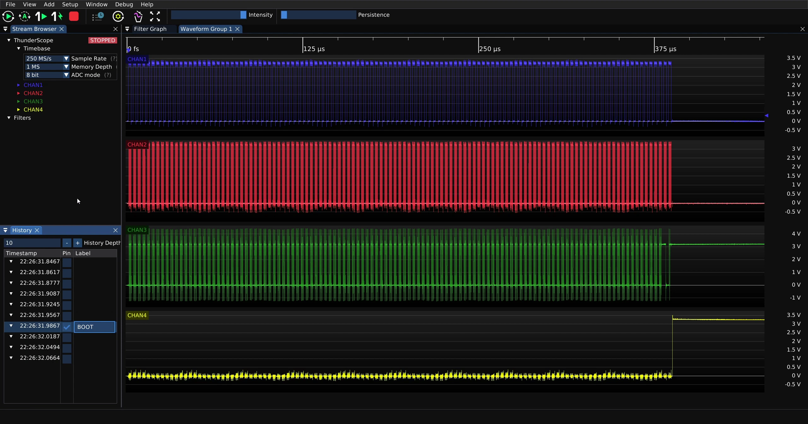

Here the pinned capture is shown at the top of the list of captures after new captures were taken.

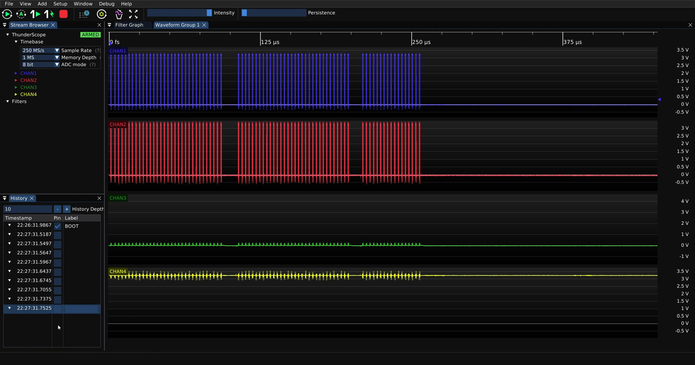

The number of captures in history can be increased or decreased using the "-" or "+" buttons in the "History" window. 
A number can also be entered directly into the "History Depth" field. All captures in history must fit in system RAM at time of writing, 
spilling to disk is planned for the future. 

.. tip::
    If you are using very high memory depths, use the lowest history depth possible in order to allocate more RAM to each capture.

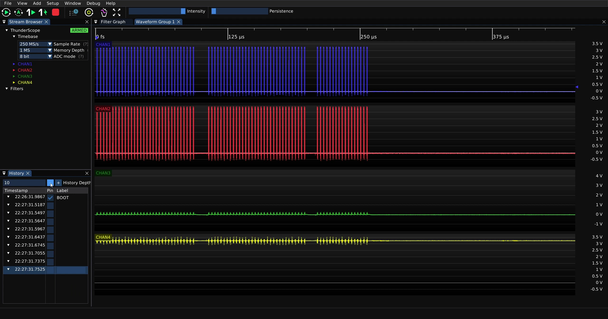

If a capture in history is labelled, the label must be removed before unpinning it. Alternatively the capture may be deleted
by right clicking it and selecting the "delete" option. 

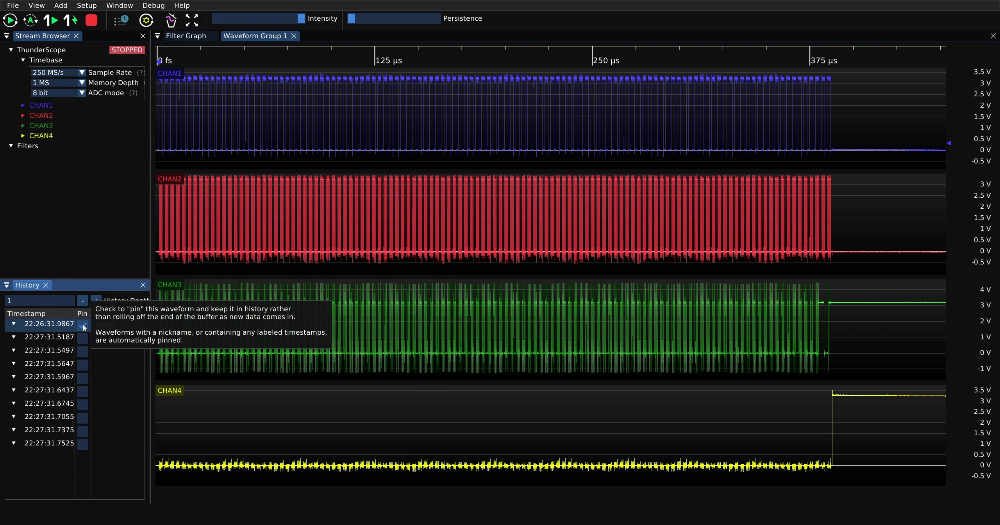

With the history depth now set to "1", every previous capture was deleted once more captures were taken and only the latest capture retained. 

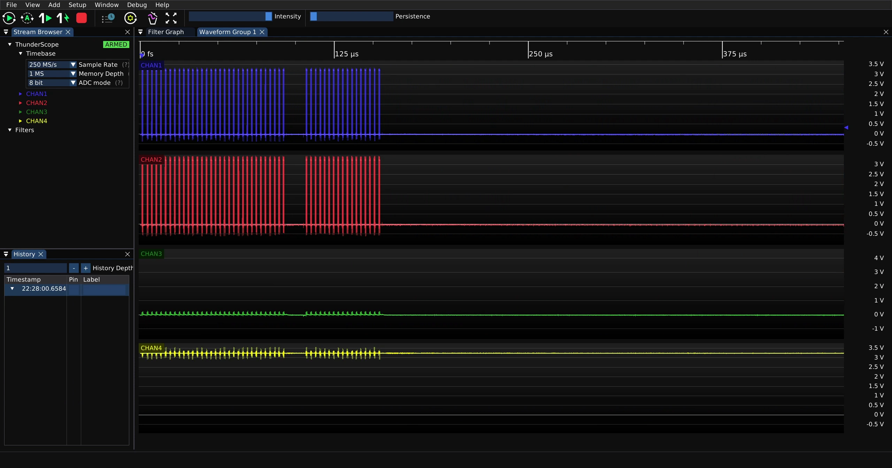

ADC Resolution
--------------

To change the ADC Resolution, click on the down arrow next to "ADC mode" on the stream browser menu

Then click on the desired ADC Resolution from the drop down menu

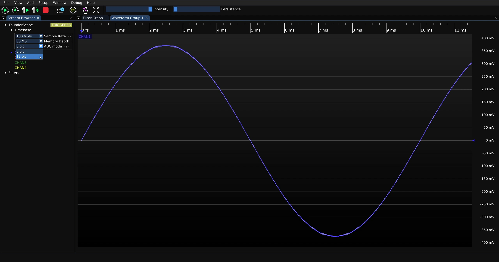

Note that when switched to 12-bit mode the stair step effect is no longer visible on the waveform 

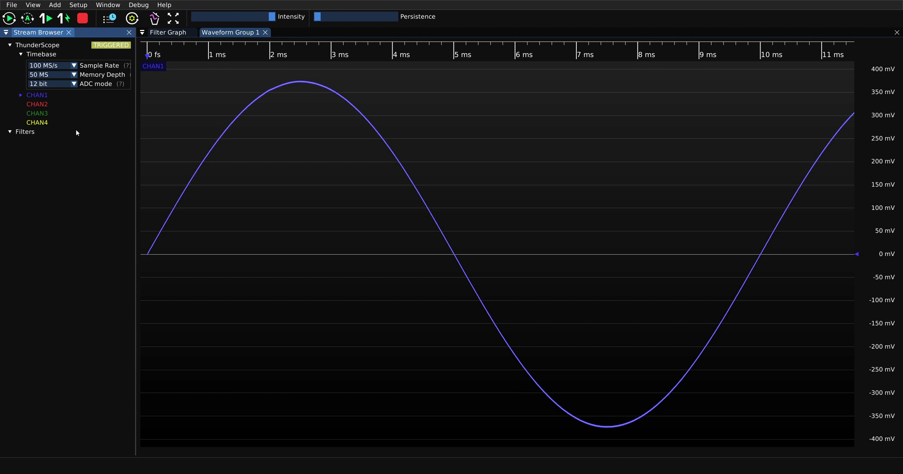

Active Channels Vs. Max. Sample Rate - 8 Bit
--------------------------------------------

The ADC used on ThunderScope splits its sample rate between channels. 
Therefore adding or removing channels will change the maximum sample rate.
This may not align with the amount of channels that are displayed, 
as a channel may still be active for triggering or being used as an input to a filter.

The maximum sample rate for a single active channel in 8 bit mode is 1 GS/s.

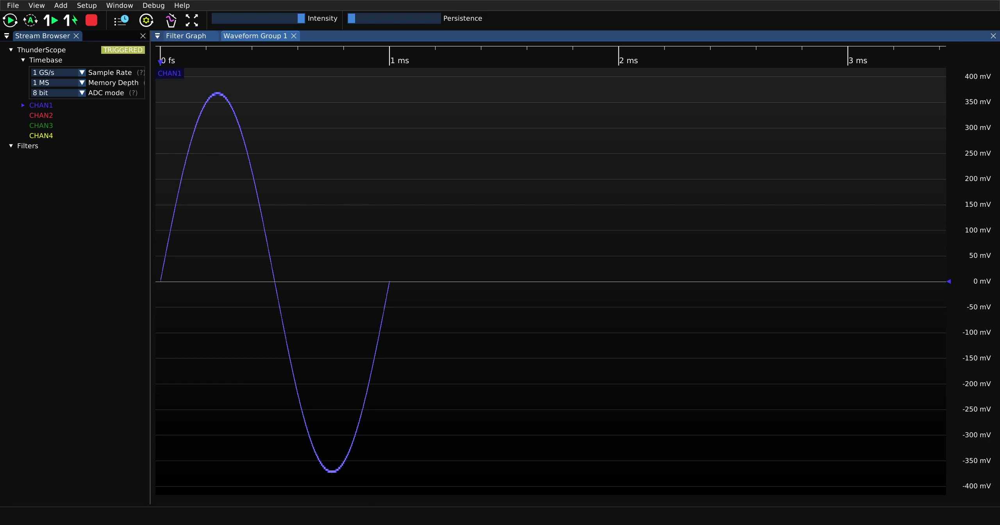

The maximum sample rate for two active channels in 8 bit mode is 500 MS/s. Note that the capture length increases on both channels.
This is because the memory depth setting is per channel memory depth, and has not changed, while the sample rate has decreased. 

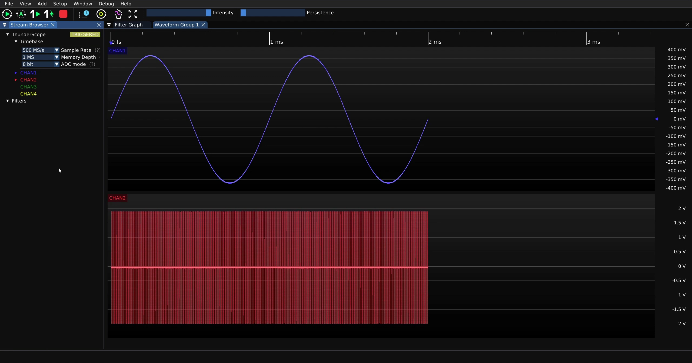

The maximum sample rate for three or four active channels in 8 bit mode is 250 MS/s. 
Note that capture length doubles again for the reason described previously. 

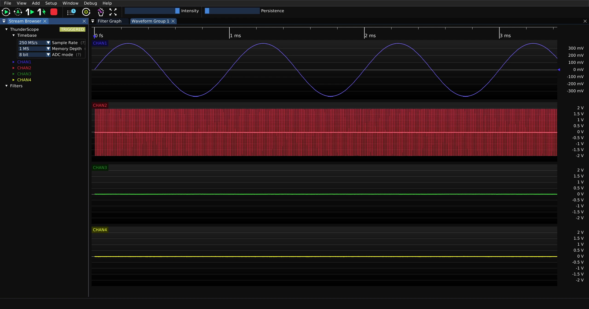

Active Channels Vs. Max. Sample Rate - 12 Bit
---------------------------------------------

The maximum sample rate for a single active channel in 12 bit mode is 660 MS/s.

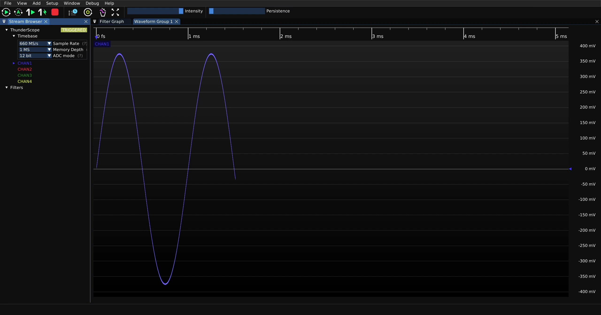

The maximum sample rate for two active channels in 12 bit mode is 330 MS/s.

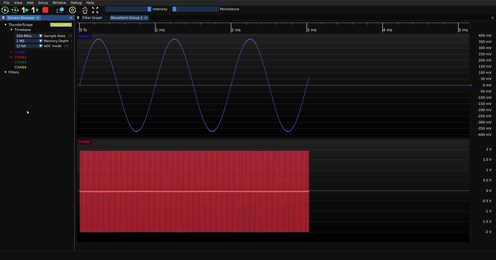

The maximum sample rate for three or four active channels in 12 bit mode is 165 MS/s. 

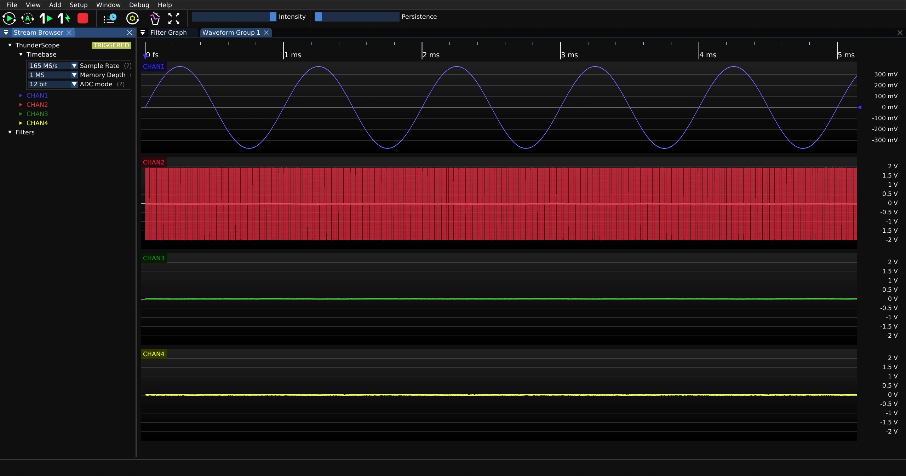
