.. _Cursors:

Cursors
=======

This guide assumes you have installed the driver and software for ThunderScope. 
If you have not already done do, please follow the :ref:`getting started guide <Getting-Started>`.

Horizontal Cursors
------------------

To enable horizontal cursors, right click on the waveform view and select an option under "Cursors -> X Axis". 

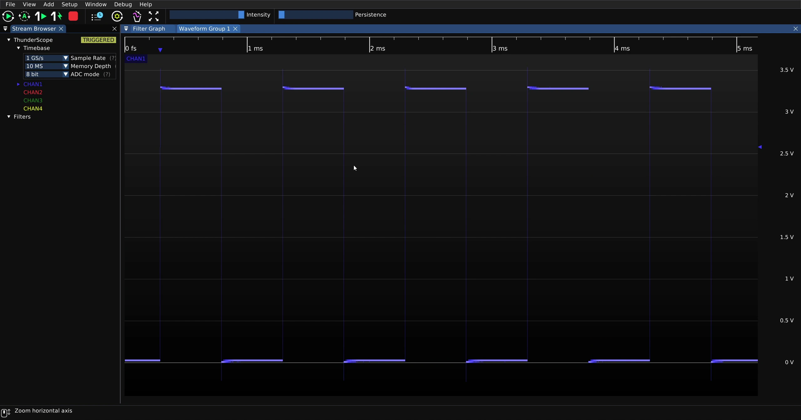

In this example, "Dual" cursors are shown.

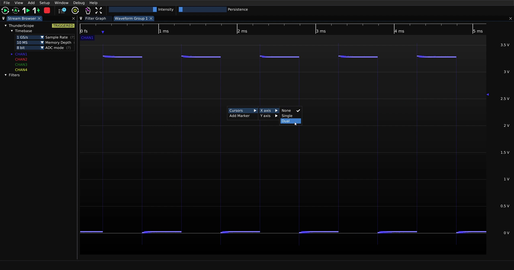

Click and drag the first cursor to the desired position.

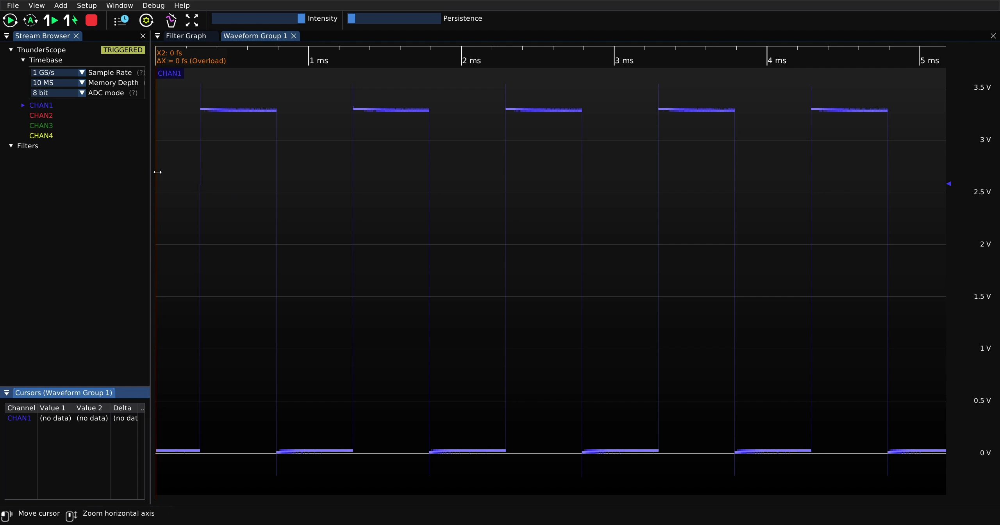

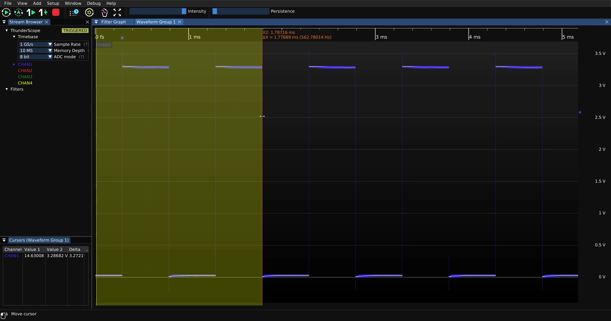

Click and drag the second cursor to the desired position.

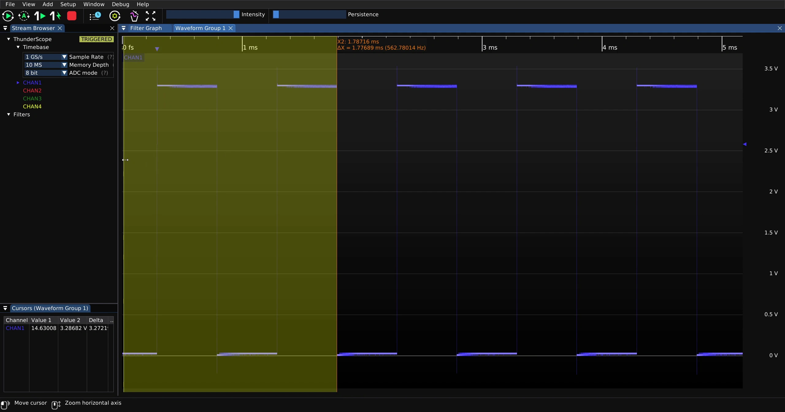

Values at each cursor as well as a delta value is displayed in the "Cursors" UI element for each waveform in the waveform group.

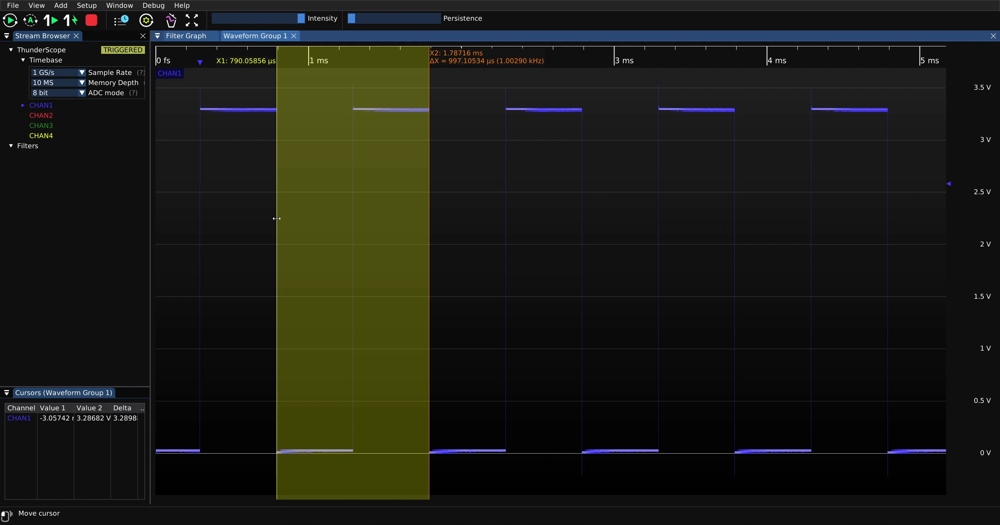

To disable horizontal cursors, right click on the waveform view and select "Cursors -> X Axis -> None"

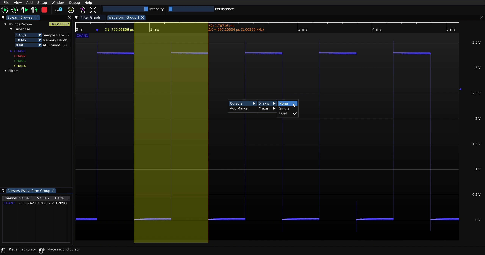

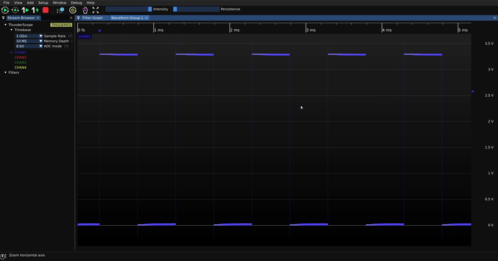

Vertical Cursors
----------------

To enable vertical cursors, right click on the waveform view and select an option under "Cursors -> Y Axis". 

In this example, "Dual" cursors are shown.

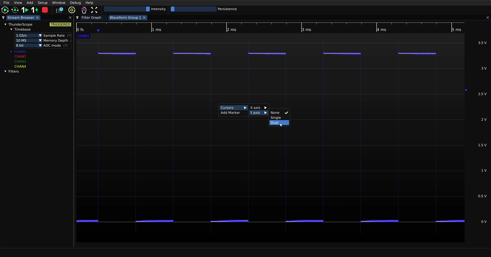

Click and drag the cursors to the desired positions.

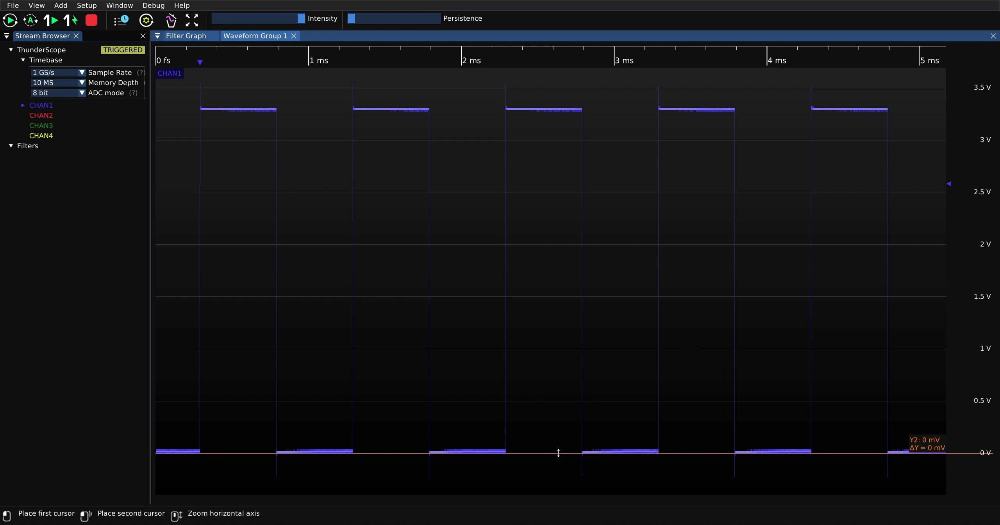

Values at each cursor as well as a delta value is displayed on the waveform view.

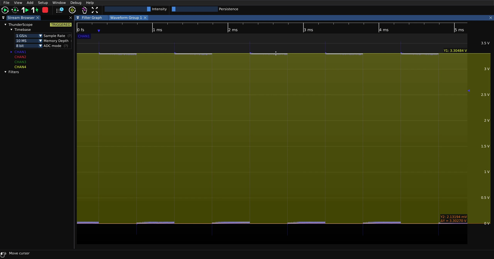

To disable vertical cursors, right click on the waveform view and select "Cursors -> Y Axis -> None"

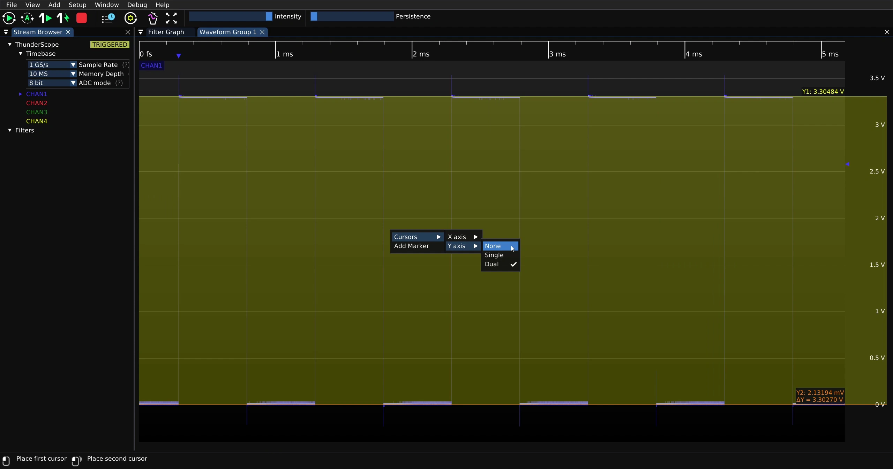

